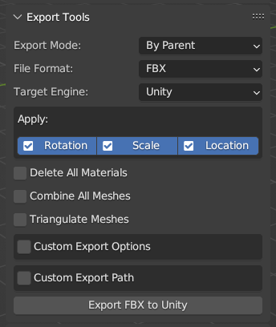
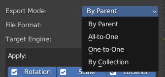
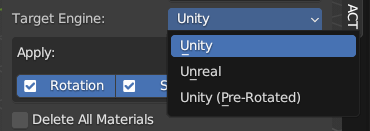
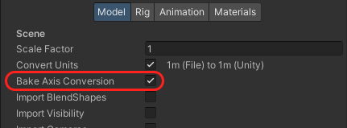

[<< Return to README](../README.md#documentation)

# Export Tools

Batch Export Selected Objects to OBJ/FBX/GLTF for Unity, UE or Godot. 

## Export Mode

* **By Parent** - Batch Objects by Parent (Each parent with children -> separate files)
* **All-to-One** - Export All Selected Object into One file
* **One-to-One** - Export Each Object into Individual file
* By Collection - Batch Objects by Collection

### Use Collection Instance Offset

Available only in **By Collection** export mode (FBX, OBJ and glTF). Disabled by default to preserve existing ACT behavior.

1. Set the collection's reference point in **Collection Properties > Instancing > Instance Offset** (X, Y, Z).
2. Select the objects to export.
3. In ACT Export Tools, choose **By Collection** and enable **Use Collection Instance Offset**.
4. Export using your usual format and target engine settings.

Each export batch is translated by the negative of its collection's Instance Offset in Blender world space, before export axis and scale conversion. For example, an object at (10, 2, 0) in a collection with offset (10, 0, 0) is exported at (0, 2, 0), in Blender coordinates before format conversion.

* **Combine All Meshes off:** individual object origins and relative positions are retained.
* **Combine All Meshes on:** the joined mesh's origin is set to the collection reference point and translated to the export origin.
* A zero offset or a disabled option uses the original positioning behavior.
* Collection grouping and selection are unchanged: ACT uses the first collection membership of each selected object.
* The translation is temporary; the original scene is restored using ACT's existing undo workflow. Constraints or drivers that prevent the requested translation can cause the export to be cancelled rather than silently exporting incorrect positions.

The default value can be set in **Preferences > Add-ons > ACT > Default Settings > Export Tools** (choose By Collection). Use **Copy Default Settings To Current Session** to apply it to the current scene. **Reset Preferences** restores the default value (off).

## Target Engine (for FBX)

You can export FBX for Unity or Unreal Engine.

### Export Algorithms for Unity

ACT has two different algorithms for export FBXs to Unity: ***"Unity"*** and ***"Unity (Pre-Rotated)"***.
s
#### "Unity" Export Profile

This profile supports Objects with Linked Data, more accurate for rigs, animations, angles and axis. ***But this export profile requires additional steps with models in Unity.*** You have to enable in model import settings option "Bake Axis Conversion".

#### "Unity (Pre-Rotated)" Export Profile

This algorithm rotate geometry for each object 90 degrees by X Axis for correct axes in Unity. This algorithm doesn't require additional actions in Unity, but has some limitations (doesn't support multi-users, animations, etc.).